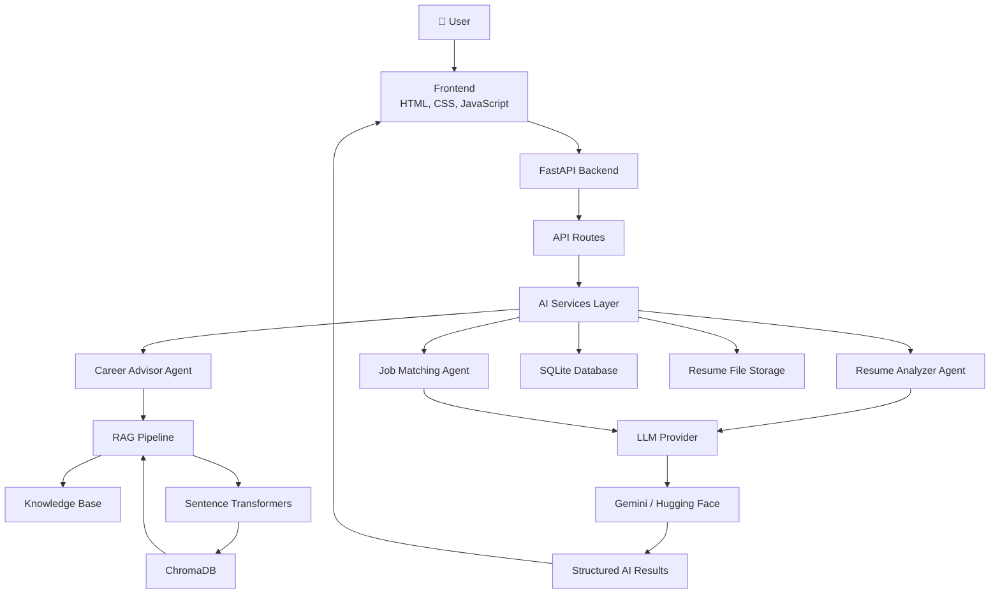
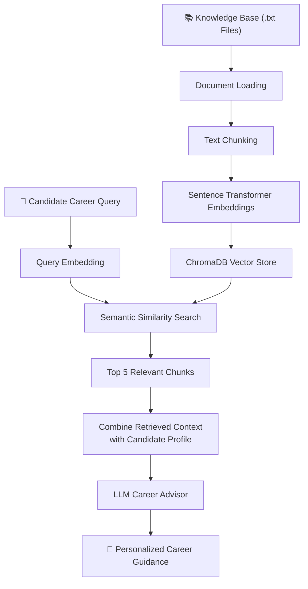

# 🚀 AI Resume Analyzer
### 🤖 AI-Powered Resume Analysis, Job Matching & RAG-Based Career Advisor

<p align="center">
  An intelligent career assistance platform that analyzes resumes, matches candidates with job opportunities, and provides personalized career guidance using Large Language Models and Retrieval-Augmented Generation (RAG).
</p>

---

## 📌 Overview

**AI Resume Analyzer** is an AI-powered career assistance platform designed to help candidates understand their professional profiles, evaluate their compatibility with job opportunities, and identify areas for career improvement.

The system combines **Large Language Models (LLMs)**, **Retrieval-Augmented Generation (RAG)**, semantic search, and structured data processing to deliver intelligent resume analysis and personalized career recommendations.

Users can upload their resumes, explore job opportunities, compare their skills against job requirements, and receive actionable recommendations through an integrated web application.

The platform consists of three main AI components:

- 📄 **Resume Analyzer Agent:** Extracts and analyzes structured candidate information from resumes.
- 🎯 **Job Matching Agent:** Evaluates candidate compatibility with job requirements.
- 🧭 **Career Advisor Agent:** Generates personalized career guidance using a RAG-powered knowledge base.

---

## ✨ Key Features

### 📄 1. AI-Powered Resume Analysis
- Upload resumes in PDF and DOCX formats.
- Automatically extract readable resume content.
- Generate structured candidate profiles.
- Identify programming languages separately from technical skills.
- Analyze education, experience, strengths, and weaknesses.
- Generate AI-powered resume summaries.

### 💼 2. Intelligent Job Analysis
- Analyze job titles and descriptions.
- Extract required and preferred skills.
- Identify experience and education requirements.
- Detect job seniority and relevant keywords.
- Store structured job information for future matching.

### 🎯 3. Resume–Job Matching
- Compare candidate skills with job requirements.
- Identify matched and missing required skills.
- Evaluate preferred skill compatibility.
- Calculate a job match score.
- Generate explanations for matching results.
- Provide improvement plans for missing skills.
- Apply skill normalization to handle naming variations.

### 🧠 4. RAG-Based Career Advisor
- Retrieve relevant information from a dedicated career knowledge base.
- Generate semantic embeddings using Sentence Transformers.
- Store and retrieve knowledge chunks through ChromaDB.
- Provide personalized learning recommendations.
- Suggest relevant certifications and learning resources.
- Generate career roadmaps and resume improvement advice.
- Ground recommendations in retrieved knowledge instead of relying only on general LLM knowledge.

### ⚙️ 5. Backend & Data Management
- RESTful API built with FastAPI.
- User registration and login.
- Resume and job management.
- Persistent application data using SQLite.
- Configurable AI providers.
- Structured JSON responses for frontend integration.

---

## 🏗️ System Architecture

The application follows a modular architecture that separates the frontend, backend API, AI services, database, and RAG knowledge base.

### 🔄 High-Level Architecture



### 🔍 Main Workflow

1. The user interacts with the frontend.
2. The frontend sends HTTP requests to the FastAPI backend.
3. FastAPI validates requests and routes them to the appropriate service.
4. Uploaded resumes are stored and converted into readable text.
5. AI services analyze resumes and job descriptions.
6. The Job Matching Agent compares candidate skills with job requirements.
7. The Career Advisor retrieves relevant knowledge from ChromaDB.
8. The selected LLM generates structured results and personalized recommendations.
9. Application data is stored in SQLite and the results are returned to the frontend.

---

## 🤖 AI Agent Architecture

The platform organizes its core AI capabilities into three specialized agents.

| Agent | Responsibility |
|---|---|
| 📄 Resume Analyzer Agent | Extracts and analyzes structured candidate information from resumes. |
| 🎯 Job Matching Agent | Compares candidate skills against job requirements and calculates compatibility. |
| 🧭 Career Advisor Agent | Uses RAG to provide personalized career guidance and learning recommendations. |

Each agent focuses on a specific task while sharing the underlying AI service layer.

---

## 🧠 RAG Pipeline

The Career Advisor uses **Retrieval-Augmented Generation (RAG)** to generate knowledge-grounded career recommendations.

### How It Works



### Retrieval Process

1. Load text documents from the `knowledge_base/` directory.
2. Split documents using `RecursiveCharacterTextSplitter`.
3. Use a chunk size of 500 characters with an overlap of 50 characters.
4. Generate normalized embeddings using Sentence Transformers.
5. Store document chunks and metadata in a persistent ChromaDB collection named `career_knowledge`.
6. Convert candidate-specific queries into embeddings.
7. Retrieve the top 5 relevant knowledge chunks.
8. Combine the retrieved context with the candidate's resume profile and missing skills.
9. Send the context to the Career Advisor LLM.
10. Return structured career recommendations.

### 📚 Knowledge Base

The knowledge base contains resources covering:

- 🛣️ Career roadmaps.
- 🏅 Certifications.
- 📖 Learning resources.
- 📝 Resume guidelines.
- ✍️ Resume improvement strategies.
- 💻 Technical and professional skills.

---

## 🛠️ Technology Stack

| Category | Technologies |
|---|---|
| 💻 Programming Language | Python |
| ⚡ Backend Framework | FastAPI |
| 🎨 Frontend | HTML, CSS, JavaScript |
| 🗄️ Database | SQLite |
| 🔎 Vector Database | ChromaDB |
| 🧠 LLM Providers | Google Gemini, Hugging Face |
| 🔢 Embeddings | Sentence Transformers |
| 📦 RAG & Text Processing | LangChain Text Splitters |
| 📄 PDF Processing | pypdf |
| 📝 DOCX Processing | python-docx |
| ✅ Data Validation | Pydantic |
| 🔐 Authentication Support | bcrypt |
| ⚙️ Environment Management | python-dotenv |
| 🌐 ASGI Server | Uvicorn |
| 🐳 Containerization | Docker, Docker Compose |

---

## 📂 Project Structure

```text
ai-resume-analyzer/
│
├── backend/
│   ├── uploads/
│   ├── coach.py
│   ├── database.py
│   ├── main.py
│   ├── models.py
│   ├── routes.py
│   ├── run_testset.py
│   └── services.py
│
├── frontend/
│   ├── coach.css
│   ├── coach.js
│   ├── index.html
│   ├── script.js
│   └── style.css
│
├── knowledge_base/
│   ├── career_roadmaps.txt
│   ├── certifications.txt
│   ├── learning_resources.txt
│   ├── resume_guidelines.txt
│   ├── resume_improvement.txt
│   └── skills.txt
│
├── chroma_db/
│   └── Persistent vector database files
│
├── Documents/
│   └── AI_Resume_Analyzer_Project_Documentation.docx
│
├── tests/
│   ├── testset_sample.csv
│   └── test_coach.py
│
├── .dockerignore
├── .env.example
├── .gitignore
├── docker-compose.yml
├── Dockerfile
├── requirements.txt
├── test.py
└── README.md
```

### 📦 Backend Components

| File | Description |
|---|---|
| `main.py` | FastAPI application and API entry point. |
| `routes.py` | API route definitions. |
| `services.py` | Core AI services, LLM integration, resume analysis, job matching, and RAG functionality. |
| `database.py` | Database connection and persistence layer. |
| `models.py` | Request and data models. |
| `coach.py` | Career coaching functionality. |
| `run_testset.py` | Test-set execution support. |

---

## 🚀 Installation & Setup

### 📋 Prerequisites

- Python installed.
- Git installed.
- Google Gemini API key or Hugging Face access token.
- Docker and Docker Compose (optional).

### 1️⃣ Clone the Repository

```bash
git clone <YOUR_REPOSITORY_URL>
cd ai-resume-analyzer
```

### 2️⃣ Create a Virtual Environment

```bash
python -m venv .venv
```

Activate it:

**Windows PowerShell:**

```powershell
.venv\Scripts\Activate.ps1
```

**Linux / macOS:**

```bash
source .venv/bin/activate
```

### 3️⃣ Install Dependencies

```bash
pip install -r requirements.txt
```

### 4️⃣ Configure Environment Variables

Create a `.env` file based on `.env.example`.

Example configuration:

```env
LLM_PROVIDER=gemini

GEMINI_API_KEY=your_gemini_api_key
GEMINI_MODEL=gemini-2.0-flash

HF_TOKEN=your_huggingface_token
HF_MODEL=Qwen/Qwen3-0.6B

EMBEDDING_MODEL=BAAI/bge-base-en-v1.5
```

Choose the desired LLM provider through `LLM_PROVIDER` and configure its corresponding credentials.

> ⚠️ **Important:** Never commit API keys, access tokens, or other sensitive credentials to GitHub.

### 5️⃣ Run the Backend

```bash
uvicorn backend.main:app --reload
```

The API will be available at:

```text
http://127.0.0.1:8000
```

Interactive API documentation:

```text
http://127.0.0.1:8000/docs
```

> If your FastAPI application instance or module path uses a different name, adjust the Uvicorn command accordingly.

---

## 🌐 API Endpoints

The backend exposes the following core API capabilities:

| Method | Endpoint | Description |
|---|---|---|
| GET | `/` | API welcome endpoint. |
| POST | `/register` | Register a new user. |
| POST | `/login` | Authenticate a user. |
| POST | `/resume/upload` | Upload and analyze a resume. |
| GET | `/resume/{resume_id}` | Retrieve a stored resume. |
| POST | `/jobs` | Create and analyze a job. |
| GET | `/jobs` | Retrieve available jobs. |
| GET | `/jobs/search` | Search jobs by title, location, or skill. |
| GET | `/jobs/{job_id}` | Retrieve a specific job. |
| PUT | `/jobs/{job_id}` | Update a job and rerun its analysis. |
| POST | `/jobs/{job_id}/match` | Match a resume against a job. |

---

## 🧪 Testing

The repository includes test-related files and a sample test dataset:

```text
tests/
├── testset_sample.csv
└── test_coach.py
```

Additional test execution support is available through:

```text
test.py
backend/run_testset.py
```

---

## 🔑 Environment Variables

| Variable | Purpose |
|---|---|
| `LLM_PROVIDER` | Selects the active LLM provider. |
| `GEMINI_API_KEY` | Google Gemini API key. |
| `GEMINI_MODEL` | Gemini model configuration. |
| `HF_TOKEN` | Hugging Face access token. |
| `HF_MODEL` | Hugging Face model configuration. |
| `EMBEDDING_MODEL` | Sentence Transformer embedding model. |

---

## 🌟 Key Design Highlights

- 🧩 **Modular Architecture:** Separates frontend, API routes, AI services, and persistence.
- 🤖 **Specialized AI Agents:** Divides resume analysis, job matching, and career advising into focused components.
- 🔄 **LLM Provider Flexibility:** Supports both Google Gemini and Hugging Face.
- 🧠 **Knowledge-Grounded Generation:** Uses RAG to ground career recommendations in project-specific resources.
- 📦 **Structured AI Outputs:** Uses structured JSON results for easier integration with the frontend.
- 🎯 **Skill Normalization:** Handles common variations in skill naming to improve matching consistency.
- 🛡️ **Fallback Matching:** Includes deterministic matching logic when LLM output is unavailable or invalid.
- 💾 **Persistent Storage:** Uses SQLite for application records and ChromaDB for vector knowledge.

---

## 🔮 Future Improvements

Potential directions for future development include:

- Expand resume evaluation and feedback capabilities.
- Improve job recommendation and ranking mechanisms.
- Add more career knowledge sources.
- Enhance evaluation metrics for resume–job matching.
- Introduce additional LLM providers.
- Improve frontend user experience and reporting.
- Expand automated testing and system evaluation.

---

## 👥 Team Members

We are a team of developers collaborating to build an AI-powered career assistance platform.

| # | Team Member | GitHub Profile |
|---|---|---|
| 1 | Mohamed Sobhy Mohamed | [@Mohamed-Sobhy-2006](https://github.com/Mohamed-Sobhy-2006) |
| 2 | Mohamed Ayman Yahya | [@MohamedAymanDev](https://github.com/MohamedAymanDev) |
| 3 | Mohamed Amir Abozaid | [@Mohamed-Amir-Abozaid](https://github.com/Mohamed-Amir-Abozaid) |
| 4 | Ahmed Badwy Mohamed | [@A7medBadwy](https://github.com/A7medBadwy) |

---

## 🎓 Acknowledgment

Developed as part of the **ITI – AI Agents & Python Internship**, demonstrating practical experience in:

- Python backend development.
- AI agent design and implementation.
- Large Language Model integration.
- Prompt engineering and structured outputs.
- Embeddings and vector databases.
- Retrieval-Augmented Generation (RAG).
- FastAPI application development.
- Integration of AI services with databases and frontend applications.

---

<p align="center">
  <b>🚀 AI Resume Analyzer</b><br>
  Turning Resumes into Actionable Career Insights. 🎯
</p>
